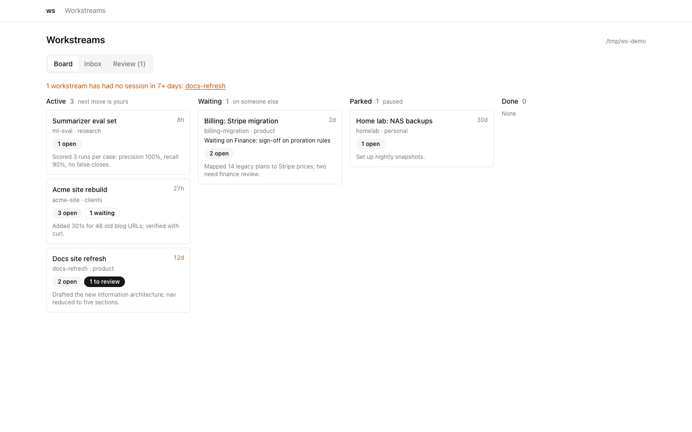
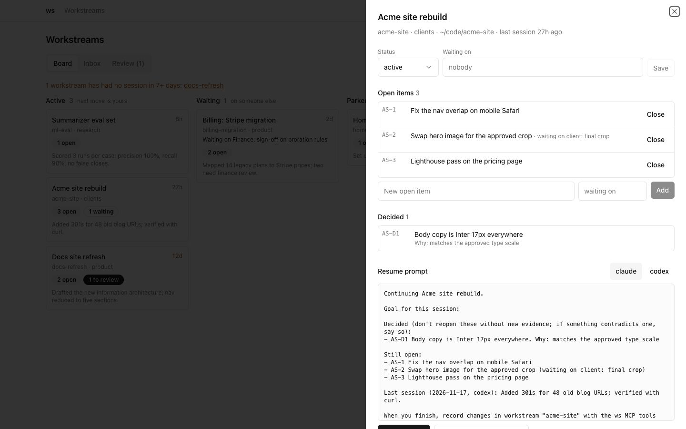

# ws

Workstream state for people who run many Claude Code, Codex and Gemini CLI sessions on the same piece of work.

A long piece of work (a client site, a migration, a research thread) spans dozens of sessions. What's still open tends to drift across memory notes, status docs and hand-written resume prompts. `ws` gives each workstream one place for:

- **open items** with stable IDs (`AB-3`), and who each is waiting on
- **decisions**, with the reasons and the rejected options, superseded rather than edited
- **a session log**, one file per session, filled in automatically by hooks
- **pointers** to the project's own docs, which ws reads rather than copies

From those it builds a fresh resume prompt whenever you start a session. Everything is plain markdown on your machine. Nothing is sent anywhere unless you turn on the optional summarizer.



## Quick start

Requires Node 20.9+ on the PATH that your agent CLIs see (hooks run `ws` through `#!/usr/bin/env node`), and at least one of Claude Code, Codex or Gemini CLI (0.26 or later, where hooks are on by default).

```bash
git clone https://github.com/justinrhowell/workstreams.git && cd workstreams
npm --prefix ws ci
node ws/bin/ws.mjs setup        # data folder, `ws` on PATH, hooks + MCP for each CLI it finds
```

`ws setup` is safe to re-run: it only adds, updates or de-duplicates hook entries that are entirely ws's, keeps a timestamped backup of any settings file it changes, and updates the MCP registration if the repo or data folder moved. Custom hooks, including ones that call ws inside a larger command, are left alone. Use `--dry-run` to see what it would do, `--claude` / `--codex` / `--gemini` to set up one tool, and `ws setup --uninstall` to remove everything it added (your data stays). Codex asks you to approve new hooks once: run `/hooks` in Codex. For Gemini CLI, the hooks and the MCP server both go in `~/.gemini/settings.json`. It honours `CLAUDE_CONFIG_DIR`, `CODEX_HOME` and `GEMINI_CLI_HOME`.

Then create a workstream for a project folder and start working:

```bash
ws new site --title "Acme site rebuild" --cwd ~/code/acme-site
ws item add site "Fix the nav on mobile" --waiting "client: final copy"
ws go site            # edit the resume prompt, then launch Claude Code in that folder
```

Sessions that start in `~/code/acme-site` are told which workstream they're in and what's open. When they end, they're logged against it. Sessions in folders no workstream claims go to `ws inbox`.

## The board (optional)

```bash
npm ci                # once, from the repo root
ws board              # http://127.0.0.1:3311
```

A local web view of every workstream: columns by status, staleness, the inbox, summarizer proposals, and per-workstream detail. It binds to 127.0.0.1 and has no login. It refuses requests from other web pages (cross-origin, DNS rebinding) and requests a typical proxy marks as coming from elsewhere, but headers can be forged, so a program that can reach the port could still get in; so keep it local: never expose it through a tunnel, proxy or `0.0.0.0`. `ws board --install` keeps it running in the background: a launchd agent on macOS, a systemd user unit on Linux.



## Parts

| Part | Where | What it does |
|---|---|---|
| CLI | `ws/bin/ws.mjs` | `setup`, `new`, `go`, `prompt`, `item`, `decide`, `log`, `inbox`, `review`, `stale`, `doctor`, `board`, … (`ws help`) |
| Hooks | `ws hook claude\|codex\|gemini start\|end` | Start: tell the session what's open. End: log it, or put it in the inbox |
| MCP server | `ws/mcp/server.mjs` | `ws_list`, `ws_show`, `ws_compose`, `ws_item_*`, `ws_decide`, `ws_log`, `ws_set_status`, `ws_inbox` |
| Summarizer | `ws/lib/summarize.mjs` | Optional. Drafts notes for sessions that ended without any, using an OpenAI-compatible chat model (self-hosted, or hosted with `llm.model` and an API key). Nothing applies until you accept it |
| Board | Next.js app in this folder | Local web view (above) |

## Configuration

Your data lives in `$WS_ROOT`, which defaults to `$XDG_DATA_HOME/ws` or `~/.local/share/ws`. It is never inside this repo. Optional settings go in `$WS_ROOT/config.json`. See [docs/CONFIGURATION.md](docs/CONFIGURATION.md) for every setting and environment variable.

## Platforms

macOS and Linux (CI runs the ws suite on both). The background board service (`ws board --install`) uses launchd on macOS and `systemctl --user` on Linux. On Windows, use WSL 2: see [docs/WINDOWS.md](docs/WINDOWS.md) for the exact setup. Native Windows isn't supported (hooks and paths assume a POSIX shell), and ws says so instead of half-working.

## More

- [docs/ARCHITECTURE.md](docs/ARCHITECTURE.md): how it works, and the rules it keeps
- [docs/CONFIGURATION.md](docs/CONFIGURATION.md): settings, environment variables, manual hook setup
- [docs/WINDOWS.md](docs/WINDOWS.md): running ws on Windows through WSL
- [CONTRIBUTING.md](CONTRIBUTING.md): development setup and how to send changes
- [TESTING.md](TESTING.md): the test suites
- [SECURITY.md](SECURITY.md): reporting a vulnerability, and the security boundary
- [CHANGELOG.md](CHANGELOG.md): what changed in each release

MIT licensed.
