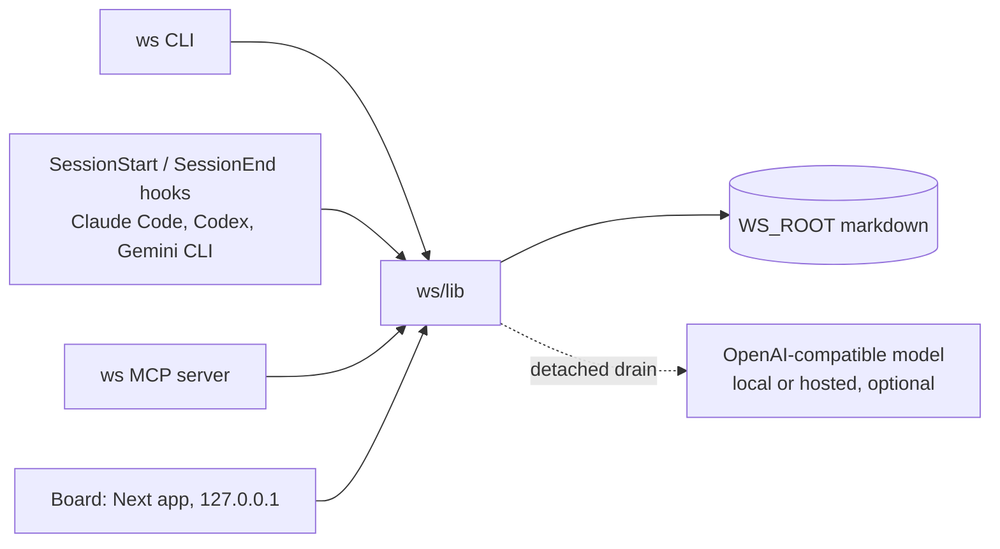

# Architecture

`ws` keeps the state of long-running work (a **workstream**) that spans many Claude Code, Codex and Gemini CLI sessions. From that state it builds a fresh resume prompt whenever a session starts.

## Each fact has one owner

The same "what's still open" list tends to drift across memory notes, status docs and pasted prompts. `ws` gives each kind of fact exactly one owner; everything else links to it or shows a generated copy.

| Fact | Owner |
|---|---|
| Open items (what's left, who it's waiting on) | `open.md` in the workstream, with stable IDs |
| Decisions (what was settled, why, what was rejected) | `decisions.md`, IDs like `AB-D2`, superseded rather than edited |
| What each session did | `log/`, one file per session (filled in when the session is adopted, resumed or summarized; never shared between sessions) |
| How this kind of work is done | `procedures/*.md`, with `{{vars}}` |
| Narrative and decisions | The project's own status doc, which ws points to |
| Rules about people and process | Claude memory notes, which ws points to (and inlines for Codex) |

## Storage

```
$WS_ROOT (default $XDG_DATA_HOME/ws or ~/.local/share/ws; never inside this repo)
├── ws/<id>/WORKSTREAM.md   frontmatter: title, status, waiting_on, cwd, sources, procedure, vars, input
├── ws/<id>/open.md         "- [ ] AB-3 text @waiting:Name"; written only through ws/lib, under a lock
├── ws/<id>/decisions.md    "- [active] AB-D2 text (date)" + why / rejected / evidence; superseded, never edited
├── ws/<id>/log/*.md        one per session: session id, tool, times, files touched, summary
├── eval/                   private summarizer eval: cases, transcript copies, floors, reports
├── .trash/<id>__<time>/    deleted workstreams with their drafts and queued jobs; `ws trash restore`
├── procedures/*.md
├── inbox/                  sessions that ended outside any workstream
├── queue/, proposals/      summarizer work and its drafts
├── config.json             optional settings: summarizer model, board port (docs/CONFIGURATION.md)
└── ignore.txt              folders whose unclaimed sessions are dropped
```

## Components



All writers go through `ws/lib`. That way item IDs are allocated once, the `open.md` lock is always taken, and the opt-in mirror block stays in sync.

- **Writes are atomic:** workstream files, logs, proposals, queue jobs and the settings files `ws setup` edits are written to a temp file and renamed (new files: hard-linked, or created exclusively where the filesystem has no hard links) into place, so a crash leaves the old version or the new one, never half a file. Symlinked files are written through to their target, and file permissions are kept.
- **Damage is refused, not overwritten:** a missing `open.md` is empty, but an unreadable one, or one with item lines ws can't parse, stops the command with an error instead of being rewritten without them. Other text a person adds to `open.md` or `decisions.md` is kept: indented lines stay under the item or decision above them (for example `owner: Dana`), and anything else moves under a `## Notes` heading.
- **Record text is one line:** newlines in item and decision text are collapsed, so text can't forge another record. Line endings are normalized, so files edited on Windows still parse.
- **Locks:** `open.md`, `decisions.md` and `WORKSTREAM.md` changes, session-log adoption and the summary drain each take a lock. A lock is taken over when it has gone 30s without a heartbeat, or at once if its owner process on this machine has exited (a hook killed by its timeout).

- **`store.mjs`** handles workstreams, open items (lock, IDs that are never reused), logs, the mirror block, and staleness. Staleness counts from the newest session end, not from file edits.
- **`compose.mjs`** builds the resume prompt: read-first sources, the input slot, the procedure, open items, the last real session summary, and recent sessions without notes. It inlines Claude memory notes when the target is Codex, and fails loudly when a path or section doesn't resolve.
- **`capture.mjs`** runs from the hooks.
  - **Matching:** a session links to a workstream when `WS_ID` is set, or when exactly one active workstream has the longest matching cwd prefix. Everything else goes to the inbox, with ranked suggestions.
  - **Filtering:** tiny sessions (one prompt, few tool calls, no edits, no ws calls) are skipped. A `ws log` written during the session is adopted rather than duplicated. With several sessions in one workstream, a session adopts a note whose text appears in its own `ws log`/`ws_log` call; a note an agent wrote (`via: agent`, from MCP or an agent's shell) is never taken by a session that logged nothing; a note typed in a terminal goes to the session that ends first.
  - **Start note:** returned as `hookSpecificOutput.additionalContext`, and it defers to the user.
  - **Transcripts:** Claude Code and Codex write one event per line. Gemini CLI writes an append-only log that re-appends a message whenever it changes and records rewinds and patches, so `gemini.mjs` folds it into the final message list before anything is counted.
- **`summarize.mjs`** drafts proposals for sessions that ended without notes. The hook only enqueues; a detached `ws summarize --drain` does the work.
  - **Model input:** a digest of the session (your prompts, assistant text, tool names with the first 140 characters of each tool's main argument; no tool output), with common credential shapes redacted first, sent in JSON mode. Server-specific fields (for example turning thinking off on vLLM) come from `llm.extraBody` in config. The reply must finish with `stop`.
  - **Validation:** a close must quote an assistant or tool line verbatim (never the user's request), must not copy the item text, and must share words with the item. A decision must quote the user. Anything that fails becomes an *unverified* suggestion, off by default. New items that restate open ones are dropped. Accepting is exclusive: the first accept claims the proposal, a second one is refused, and if a newer draft replaced it since you opened it, the accept stops so you can review the new one. Each step (decision, close, add, summary) is recorded right after it lands, so an accept interrupted by a crash or an error shows up again in `ws review`, and accepting it again skips the recorded steps. A crash in the instant between a step and its record can repeat that one step. A step that fails softly (for example closing an item someone already closed) is reported in the result and counted as done.
  - **Failures:** endpoint outages, bad keys and rate limits never use up a job's attempts and stop the drain until later. A timeout or server error while the endpoint is otherwise up moves on to the next job; after 10 of those, the job goes to `queue/failed`.
  - **Review:** proposals apply only through `ws review accept` or the board. Accepting never overwrites notes someone wrote.

## Quality gates

- **State correctness** (`ws/test/state-correctness.test.mjs`): once an item is closed or a decision superseded, it must not appear as current in any surface. That covers the resume prompt (Claude, Codex, inline), the session-start note, the mirror block, the MCP `ws_show` and `ws_compose`, and the summarizer's input. The test was checked by deliberately breaking the filters.
- **Summarizer eval** (`ws eval`): scores proposals on your own real sessions with known correct closes, kept in `$WS_ROOT/eval` (your data, never in this repo), and fails below the floors (defaults: verified precision 100%, recall 50%, no false verified closes; override them in `eval/floors.json`). Run it before changing the prompt, model or validator. The case format is documented at the top of `ws/lib/eval.mjs`.

## Recall

- `ws go <id>` opens the composed prompt in `$VISUAL`, else `$EDITOR`, else `nano` (run through `sh`, so `code --wait` works), with the cursor on the input slot when the editor supports `+LINE` (nano, vim, nvim, emacs, micro). On save it launches `claude -n "<title>"` or `codex` in the workstream's cwd with `WS_ID` set. `--resume` reuses a session from the last 12 hours.
- `ws prompt <id>` copies the prompt for desktop or web apps.
- The MCP tools (`ws_show`, `ws_compose`, `ws_item_*`, `ws_log`, …) give both CLIs a native way to read and write.
- `ws find`, the `ws_find` MCP tool and the board's search box share `ws/lib/search.mjs`. It scans the files on each query; there is no index to keep in sync, and at this size a scan takes milliseconds. Every word must match within one record (a workstream, an item, a decision, a session log or an inbox entry). An ID-shaped word like `BG-3` matches whole IDs only, so it doesn't find `BG-30`. Closed items and superseded decisions are included, because finding history is the point, but they rank after current records and every surface labels them (`[closed item]`, `[superseded decision → …]`, a struck-through row on the board). `--current` / `current: true` leaves them out.
- A "park" or handoff skill in your agent setup can call the same MCP tools to record what a session changed before you switch away.

## Board

The board is the Next app at `/`. Its API routes import `ws/lib` directly.

- **Security boundary:** the board is for this machine only and has no login. It binds to `127.0.0.1`. Every API request, read or write, needs a local `Host`, a same-origin `Origin` if one is sent, and no proxy headers; writes also need JSON. That blocks cross-site requests and DNS rebinding from web pages. It does not authenticate a local process, so never expose the board through a proxy, tunnel or `0.0.0.0`.

## Platforms

- **macOS:** everything, including `ws board --install` (a launchd agent).
- **Linux:** everything. `ws board --install` writes a systemd user unit to `~/.config/systemd/user/<label>.service` (honouring `XDG_CONFIG_HOME`) and enables it with `systemctl --user`; logs go to the journal (`journalctl --user -u ws.board.service`). User services stop when you log out unless you run `loginctl enable-linger`. Without `systemctl --user` (some containers, WSL without systemd), run `ws board` in a terminal. Clipboard copy uses `wl-copy`, `xclip` or `xsel`.
- **Windows:** through WSL 2, which behaves like Linux; [WINDOWS.md](WINDOWS.md) has the setup and its pitfalls (a Windows `node.exe` on PATH, files under `/mnt/c`, agent CLIs installed on the Windows side). Under WSL, ws copies with `clip.exe` and opens pages with `wslview` or `explorer.exe` when no Linux tool is set up. Native Windows is refused by every entry point; hooks exit 0. A `windows-latest` CI job checks that.

## History

`ws` grew out of GoPrompt, a markdown prompt library. The prompt library was removed when ws was published; only the board's Next.js shell remains from it.
